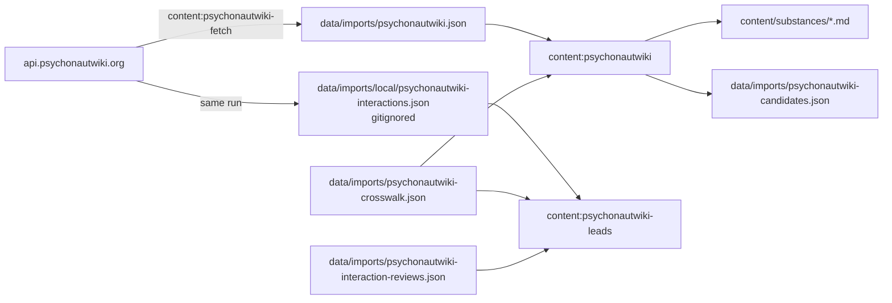

# PsychonautWiki community data — design

Date: 2026-11-06. Status: approved in session (scope, unmatched-substance policy and design). Source research: [docs/psychonautwiki-source-research.md](../../psychonautwiki-source-research.md).

## Goal

Use PsychonautWiki's structured dose and duration ranges as attributed **community** records on existing BHWiki articles whose identity is reviewed as the same substance. Collect PsychonautWiki interaction pairs as unpublished, local review leads for primary-source verification. Create no new articles.

## Decisions

| Question | Decision |
| --- | --- |
| Import scope | Dose bands and duration ranges, plus interaction review leads |
| PsychonautWiki substances without a BHWiki article | Enrich existing articles only; list the rest in a candidates file |
| Acquisition channel | GraphQL API (`https://api.psychonautwiki.org/`), the only channel PsychonautWiki sanctions ("Please don't crawl the wiki. Use our API instead."). `robots.txt` disallows `/w/api.php`. |
| psy.is | Not used. It is a search redirect, not a permalink, and the domain registration expires 2026-11-21. Links stay `https://psychonautwiki.org/wiki/<Title>`. |
| Interaction data | Never committed or published. Some PsychonautWiki interactions are "sourced from TripSit", whose chart is "All Rights Reserved". The 1,957 API entries name only 68 distinct targets, the shape of TripSit's combo categories. |

## Facts this design relies on

All are cited in the research document.

- Semantic data (doses, durations, routes, interactions) is CC BY 4.0 "when properly attributed". Prose is CC BY-SA 4.0. Files and experience reports belong to their owners.
- The API serves a snapshot built about 2026-06-23 and has stopped revalidating. It exposes no revision IDs. Its `effects` and `summary` fields are broken.
- Dose and duration values carry no per-value citations. The infobox disclaimer reads: "PW's dosage information is gathered from users and resources for educational purposes only. It is not a recommendation and should be verified with other sources for accuracy."
- 373 API substances; 277 have at least one dose band. Exact name/alias matching against the 340 BHWiki articles yields 54 pairs over 53 articles. Several are wrong identities (below).
- Dose units seen: `mg`, `µg`, `μg` (Greek mu), `g`, `mL`, `seeds`, `mg/kg of body weight`. Duration units: `seconds`, `minutes`, `hours`, `days`, `Hours`, `hour`. Routes: oral, insufflated, smoked, sublingual, intravenous, rectal, inhaled, transdermal, intramuscular, buccal.

## Architecture

Offline snapshot plus reviewed crosswalk, written to Markdown, follows the Molekul importer. Pages never call the API. Rejected alternatives: runtime fetching (a stale, partly broken API becomes a page dependency and bypasses validation and revisions) and a sidecar dataset merged at load time (a second content path beside the Markdown the pages and publisher read).

## Components

| File | Responsibility |
| --- | --- |
| `scripts/psychonautwiki-data.ts` | Shared types, normalization, mapping, crosswalk validation, name matching, apply/strip |
| `scripts/fetch-psychonautwiki.ts` | One `/health` GET and one GraphQL POST. Writes the committed snapshot (no interactions) and the gitignored interaction capture |
| `scripts/import-psychonautwiki.ts` | Offline import from snapshot + crosswalk into Markdown; writes candidates |
| `scripts/psychonautwiki-interaction-leads.ts` | Prints unreviewed interaction leads; validates the review log |
| `data/imports/psychonautwiki-crosswalk.json` | Reviewed identity decisions |
| `data/imports/psychonautwiki-interaction-reviews.json` | BHWiki's review outcomes (slug, target, outcome, interaction id, note, date) |
| `data/imports/local/.gitignore` | Keeps the interaction capture out of Git without touching the root `.gitignore` |

## Crosswalk

Each entry is `{ slug, pwName, relation, reason? }`. `relation` is `same-substance` (receives data), `preparation` (PsychonautWiki page describes a preparation containing the compound; no data) or `rejected` (wrong identity; no data). Non-`same-substance` entries require a reason. One `same-substance` entry per article. The importer and a test fail while any exact name/alias match lacks an entry.

Initial decisions for the 2026-11-06 snapshot: 47 `same-substance` (46 with values; Kava has none); `preparation` for psilocybin → Psilocybin mushrooms, mitragynine → Kratom, delta-9-thc → Cannabis and cannabis → Cannabis; `rejected` for choline → Choline bitartrate (salt with its own article), dmt → 1,3-Butanediol (PsychonautWiki lists "DMT", "Dimethyltryptamine" and "Dmitri" as common names of 1,3-butanediol), psychedelic-01a08b04 → Psychedelic (class page).

`preparation` covers an identity mismatch between a preparation and a compound in either direction. PsychonautWiki's Cannabis bands are milligrams of THC (oral common 5–10 mg) and its Psilocybin mushrooms bands are milligrams of psilocybin (common 10–25 mg): neither matches the plant article `cannabis`, the isolated-compound articles `delta-9-thc` and `psilocybin`, or mushroom material. Each decision was checked against the snapshot's dose units and common band, not only the name.

## Mapping

| PsychonautWiki | BHWiki |
| --- | --- |
| `threshold` | Dose record "Threshold dose", `quantity` only |
| `light`/`common`/`strong` `{min,max}` | Dose records "Light/Common/Strong dose band" |
| `heavy` | "Heavy dose band (N unit and above)", `quantityMax: null` |
| Dose record context | `sourceCategory: community`; `ingredient` = article name; `route` = mapped label; formulation, frequency, duration, population `Not established` (hidden by the UI); purpose "PsychonautWiki dosage classification"; note names the snapshot date |
| `onset` | Duration phase `onset`, `basis: elapsed-since-exposure` |
| `comeup`, `peak`, `offset` | Phases with `basis: phase-duration` |
| `afterglow` | Phase `after-effects`, `basis: phase-duration` |
| `total` | Route `total` |
| Duration route context | `id: psychonautwiki-<route>`, `measurement: subjective`, population "Ranges compiled by PsychonautWiki contributors" |
| `μg` (U+03BC) | `µg` (U+00B5, used by existing content) |
| `Hours`, `hour`, `seconds` | `hours`, `seconds` |
| `insufflated` / `smoked` / `inhaled` | "Intranasal (insufflated)" / "Smoked" / "Inhaled", so existing route tabs group them |
| Unsupported units (`seeds`, `mg/kg…`, `days`), reversed or half-specified bands | Import fails, naming the substance and route; resolve by crosswalk decision |
| Bioavailability, tolerance, addiction, toxicity, effects, summary, images, prose, interactions | Not imported |

Each enriched article gains one reference, id `psychonautwiki`: authors "PsychonautWiki contributors", canonical page URL, kind "Community wiki data · CC BY 4.0", insight with snapshot and retrieval dates, the CC BY 4.0 link and BHWiki's normalization; limitation quoting the disclaimer and noting the absence of per-value citations.

## Invariants

1. The import adds or replaces only dose records and duration routes whose `sourceId` is `psychonautwiki`, and the reference with id `psychonautwiki`. Removing those (`withoutPsychonautWiki`) restores the pre-import record exactly. Prose, links, `reviewedAt` and `editorialStatus` are untouched.
2. Articles that are not `same-substance` carry no `psychonautwiki` records; the importer strips any left over from a changed decision.
3. Editorially reviewed articles are refused.
4. The committed articles equal a fresh import of the committed snapshot.

## Model and UI changes

- `TimeUnit` gains `seconds`. Eight imported routes have sub-minute phases (e.g. nicotine smoked onset 5–20 s); converting to minutes would display "0.08–0.33 min". `formatSpan` labels `s`; a shared `toMinutes` serves elapsed charts and timing markers; the validator accepts `seconds`.
- `DurationTimeline` currently replaces the curated timing card (onset/peak/duration text or the marker chart) whenever a timeline exists. Twenty of the 47 articles would lose displayed research timing, including citicoline's marker chart (covered by `tests/e2e/research.spec.ts`). The curated card now renders whenever it has content, followed by the routes. Six existing timeline articles (alpha-gpc, choline-bitartrate, dmt, gaba, nicotine, tadalafil) therefore also show their curated card.

No database migration: article documents are JSONB, timelines live in the document, and `bhwiki.doses.source_category` already allows `community`.

## Interaction leads

`content:psychonautwiki-leads [--slug <slug>]` reads the local capture, crosswalk and review log and prints, per `same-substance` article, PsychonautWiki pairs with the target resolved to a BHWiki article (crosswalk, then unique exact name/alias match) or class concept (antihistamine, benzodiazepine, deliriant, depressant, dissociative, opioid, psychedelic, stimulant). It omits pairs already present as BHWiki interactions and pairs already in the review log. Curators add interactions citing primary sources, then log `added` (with the interaction id) or `rejected`.

## Licensing and documentation

`CONTENT-LICENSE.md`, `README.md`, `docs/content-sources.md`, `docs/reference-research.md`, `data/imports/README.md` and `content/templates/README.md` change from "PsychonautWiki is link-only" to "PsychonautWiki structured dose and duration ranges are used under CC BY 4.0 with attribution; prose, interactions, effects and files are not redistributed."

## Testing

- Unit: band mapping (open-ended heavy, micro sign, reversed band, unsupported unit), duration mapping (seconds, basis, empty phases, unsupported unit), canonical URLs, apply/strip round trip and reviewed-article refusal, snapshot formatting.
- Corpus: crosswalk completeness, data only on `same-substance` articles, preparation decisions for psilocybin/mitragynine/delta-9-thc, committed content equals a fresh import, launch-collection hashes after stripping PsychonautWiki records.
- Leads: target resolution, curated and reviewed pairs omitted, review-log validation.
- Smoke: import, `content:validate`, unit tests, bundled build, Playwright, and browser checks of LSD, nicotine, citicoline and psilocybin pages.

## Changes after design approval

- The importer does not add PsychonautWiki links. The approved design added one when absent. Dropping it keeps invariant 1 exact (stripping restores the original record), which lets the launch-collection hash guard stay meaningful; same-substance articles still link the page through their `psychonautwiki` reference. The crosswalk's `link-only` relation became `preparation`.
- The `DurationTimeline` change was discovered while mapping data and is required to avoid hiding research timing.

## Out of scope

Reading Semantic MediaWiki through `api.php` (needs permission from team@psy.is), creating articles, automatic refresh, importing effects or bioavailability, and UI beyond the timing card.
